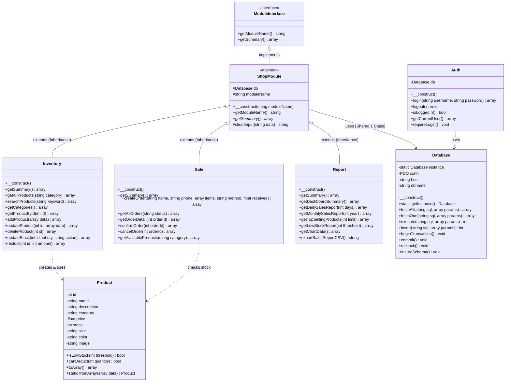

# สรุปโครงสร้างเชิงวัตถุ (OOP Architecture) ในภาษา PHP
## ระบบร้านขายเสื้อ (ShirtShop)

โครงการนี้ได้รับการพัฒนาด้วยภาษา **PHP 8** ตามหลักการ **Object-Oriented Programming (OOP)** ครบถ้วนทั้ง 4 เสาหลัก (Encapsulation, Inheritance, Abstraction, Polymorphism) พร้อม Design Patterns:
- **3 Class หลักแยกรับผิดชอบคนละ Class** (Inventory, Sale, Report)
- **1 Class ใช้งานร่วมกัน** (Database - Singleton Pattern)
- **ระบบยืนยันตัวตน (Authentication & Login)** พร้อม Session Management
- **ระบบคิดเงินทอน, เลือกช่องทางชำระเงิน และพิมพ์ใบเสร็จรับเงิน**
- **ระบบส่งออกรายงาน Excel (CSV)** และ **เติมสต็อกด่วน (Quick Restock)**

---

## 🏛️ โครงสร้างความสัมพันธ์ของ Class (Class Diagram)

---

## 👥 การแบ่งหน้าที่รับผิดชอบในกลุ่ม

| คลาส (Class) | ผู้รับผิดชอบ | ไฟล์ | หน้าที่และความรับผิดชอบหลัก |
|---|---|---|---|
| **Database** *(Shared)* | **ทุกคนใช้ร่วมกัน** | `classes/Database.php` | เชื่อมต่อ MySQL ด้วย PDO, จัดการ Query, ป้องกัน SQL Injection, จัดการ Transaction (Commit/Rollback) และ Auto-Migration สร้างตารางอัตโนมัติ |
| **Inventory** *(Class 1)* | **คนที่ 1** | `classes/Inventory.php` | จัดการสินค้าเสื้อ สต็อก หมวดหมู่ (เสื้อยืด, โปโล, Oversize ฯลฯ) เพิ่ม แก้ไข ลบ ค้นหา และระบบเติมสต็อกด่วน |
| **Sale** *(Class 2)* | **คนที่ 2** | `classes/Sale.php` | หน้าขาย POS, ตะกร้าสินค้า, ระบบชำระเงิน (เงินสด/พร้อมเพย์/บัตร), คำนวณเงินทอน, บันทึกออเดอร์, ตัดสต็อก, คืนสต็อก และสร้างข้อมูลสำหรับพิมพ์ใบเสร็จ |
| **Report** *(Class 3)* | **คนที่ 3** | `classes/Report.php` | ภาพรวม Dashboard, สถิติยอดขายรายวัน/เดือน, สินค้าขายดี Top 5, สต็อกใกล้หมด, ข้อมูลกราฟ Chart.js และส่งออกข้อมูลเป็นไฟล์ Excel (CSV) |
| **Auth** *(Security/Session)* | **ระบบเสริม** | `classes/Auth.php` | ระบบล็อกอิน, ตรวจสอบรหัสผ่าน Password Hash, จัดการ Session, ออกจากระบบ |

---

## 🔑 บัญชีผู้ใช้งานระบบ (Login Accounts)

| Username | Password | สิทธิ์ (Role) | คำอธิบาย |
|---|---|---|---|
| `admin` | `admin123` | Admin | ผู้ดูแลระบบ มีสิทธิ์เข้าถึงทุกฟังก์ชัน |
| `cashier` | `cashier123` | Cashier | พนักงานขายหน้าร้าน |

---

## 🚀 ฟังก์ชันการทำงานที่ครบถ้วนในระบบ (Complete Features)

1. **ระบบ Authentication & Security**:
   - หน้า Login ดีไซน์โมเดิร์น พร้อมปุ่มกดเติมข้อมูลตัวอย่าง 1 คลิก
   - Session Protection บังคับล็อกอินก่อนเข้าหน้าหลัก
   - ปุ่มออกจากระบบ (Logout) ในแถบ Topbar
2. **ระบบจัดการสต็อกและหมวดหมู่สินค้า (Inventory)**:
   - กรองสินค้าตามหมวดหมู่ (เสื้อยืด, เสื้อโปโล, Oversize, เสื้อฮาวาย ฯลฯ)
   - เพิ่ม/แก้ไข/ลบสินค้า พร้อมรูปภาพ
   - ปุ่มกด **➕ เติมสต็อกด่วน (Quick Restock)** ปรับสต็อกได้ทันที
3. **ระบบขายหน้าร้าน (POS) & การคิดเงิน**:
   - เลือกซื้อสินค้าลงตะกร้า ปรับเพิ่ม/ลดจำนวนได้
   - เลือกช่องทางชำระเงิน: **💵 เงินสด (Cash)**, **📱 พร้อมเพย์ (PromptPay)**, **💳 บัตรเครดิต**
   - ปุ่มลัดรับเงินสด (฿100, ฿500, ฿1,000, พอดี) พร้อมระบบ**คำนวณเงินทอนอัตโนมัติ**
4. **ระบบพิมพ์ใบเสร็จรับเงิน (Printable Thermal Receipt)**:
   - ออกใบเสร็จรับเงินทันทีหลังชำระเงินสำเร็จ
   - ดีไซน์ใบเสร็จแบบกระดาษเทอร์มอลมาตรฐาน มีหัวบิล รายการ ราคา ยอดรวม เงินที่รับ เงินทอน
   - กดปุ่ม **🖨️ สั่งพิมพ์ใบเสร็จ** พิมพ์ออกเครื่องพิมพ์หรือบันทึกเป็น PDF ได้ทันที
5. **ระบบประวัติคำสั่งซื้อ (Orders)**:
   - ดูรายการคำสั่งซื้อ กรองตามสถานะ (ยืนยันแล้ว, รอยืนยัน, ยกเลิก)
   - ดูรายละเอียดบิลและกดพิมพ์ใบเสร็จย้อนหลังได้ทุกคำสั่งซื้อ
   - กดยกเลิกคำสั่งซื้อเพื่อคืนสต็อกสินค้าอัตโนมัติ (Transaction Rollback)
6. **ระบบรายงานและวิเคราะห์ข้อมูล (Reports & Analytics)**:
   - กราฟสถิติยอดขายย้อนหลัง 7 วัน (Chart.js)
   - รายงานยอดขายรายวัน และรายเดือน
   - อันดับสินค้าขายดี Top 5 (เหรียญทอง/เงิน/ทองแดง)
   - รายการแจ้งเตือนสินค้าสต็อกใกล้หมด พร้อมปุ่มเติมสต็อกทันที
   - ปุ่ม **📥 ส่งออก Excel (CSV)** รองรับภาษาไทยสมบูรณ์แบบ
7. **หน้าร้านออนไลน์สำหรับผู้ซื้อ (Customer Online Storefront - `shop.php`)**:
   - หน้าเลือกซื้อสินค้าสำหรับลูกค้าทั่วไป ไม่ต้องล็อกอิน
   - ค้นหาเสื้อผ้า และกรองตามหมวดหมู่แบบ Real-time
   - ตะกร้าสินค้าออนไลน์แบบ Slide-in Drawer พร้อมแจ้งเตือนจำนวนสินค้า
   - กรอกชื่อ เบอร์โทร และที่อยู่จัดส่งพัสดุ
   - เลือกช่องทางชำระเงิน: พร้อมเพย์ QR Code, เก็บเงินปลายทาง (COD), บัตรเครดิต
   - ระบบตรวจสอบและติดตามสถานะคำสั่งซื้อ (Order Tracking) ด้วยเบอร์โทรหรือเลขที่ออเดอร์
